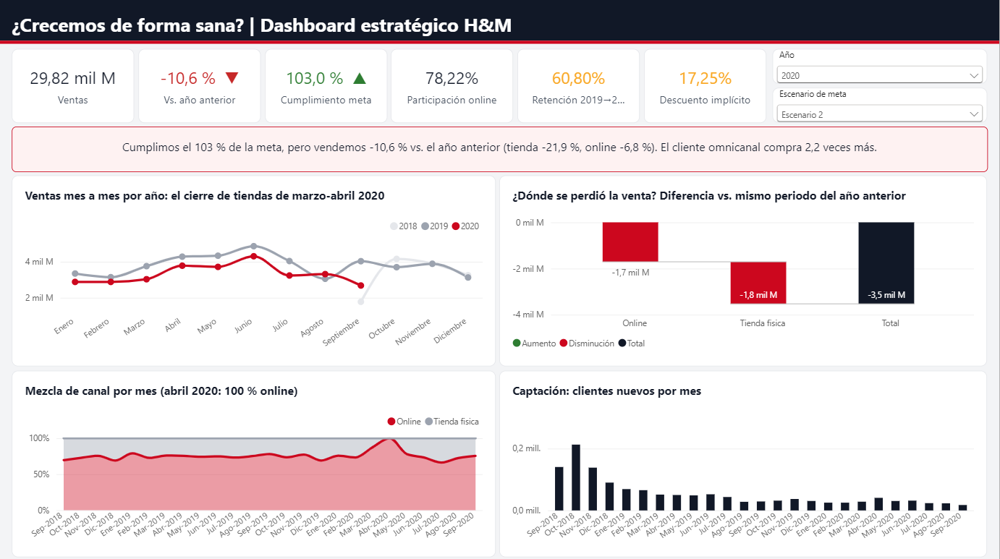

# Inteligencia de Negocios — Proyecto H&M

Solución BI completa sobre el dataset de ventas de H&M:
**CSV / Excel → STAGE → Data Warehouse (SSIS) → Cubo tabular (SSAS) → Power BI**.
Sigue las guías del curso incluidas en el repositorio: `proceso_bi_parte 1 y  2.pdf` (SSIS) y
`Cubos Tabulares y Pbi.pdf` (SSAS + Power BI).

## Estructura

| Carpeta | Contenido |
|---|---|
| `data/examen_bi/` | Datos de origen. **Solo está `GoalsHyM.xlsx`**; los CSV no se suben por su tamaño (ver abajo) |
| `sql/` | Scripts de creación de `STAGE_HM` y `DWH_HM`, validaciones y vistas para el cubo |
| `H&M/` | Solución de Visual Studio `H&M.sln`: proyectos SSIS `stage_H&M` y `DWH_H&M` + proyecto tabular |
| `Tabular_HM/` | Cubo tabular (compatibilidad 1200): `Model.bim`, generador, despliegue y `MEDIDAS_DAX.md` |
| `PowerBI/` | Informe `HM_Dashboard.pbip` (conexión en directo al cubo) y script de formato |
| `herramientas/generador_ssis/` | Generador de los paquetes SSIS (API de SSIS 2025) |
| `docs/` | **Informe y guion de presentación** (`Informe_Proyecto_HM.docx`), indicadores verificados y capturas |

## Datos de origen (no incluidos)

Copiar en `data/examen_bi/` antes de ejecutar el ETL:

| Archivo | Filas | Tamaño |
|---|---|---|
| `transaction.csv` | 31,788,324 | 3.4 GB |
| `customers.csv` | 1,371,980 | 207 MB |
| `articles.csv` | 105,542 | 36 MB |
| `DimFecha.csv` | 734 | 47 KB |
| `Temporada.csv` | 9 | <1 KB |

Si se usan en otra ruta, cambiar el parámetro de proyecto **`RutaDatos`** del proyecto `stage_H&M`.

## Entorno

- SQL Server 2025 **Developer**, instancia `LAPTOP-IO596P6A\DEV` (motor + Integration Services). Memoria máxima configurada en 3 GB.
- Analysis Services 2025 en modo tabular: `localhost\TABULAR`.
- Visual Studio 2022 con *SQL Server Integration Services Projects* y *Analysis Services Projects*.
- Power BI Desktop.

> Si cambia el nombre del servidor, actualizar las cadenas de conexión de los `.conmgr`,
> `Tabular_HM/gen_bim_hm.py` y `PowerBI/HM_Dashboard.SemanticModel/modelReference.json`.

## Cómo ejecutarlo

1. **Bases de datos** (en `LAPTOP-IO596P6A\DEV`): ejecutar en orden `sql/01_crear_STAGE_HM.sql` y `sql/02_crear_DWH_HM.sql`.
2. **ETL**: abrir `H&M/H&M.sln` y ejecutar `stage_H&M/MasterExecuteStage.dtsx` (≈ 7 min) y luego
   `DWH_H&M/MasterExecuteDWH.dtsx` (≈ 37 min, FactVentas tiene 31.8 M filas).
3. **Validar**: `sql/03_validaciones.sql` (cada tabla contra su archivo de origen, montos y calidad de datos).
4. **Cubo**: `sql/04_vistas_cubo.sql`, y en `Tabular_HM/`:
   ```powershell
   python gen_bim_hm.py Model.bim
   .\deploy.ps1 -BimPath .\Model.bim      # implementa y procesa (≈ 5 min)
   ```
5. **Power BI**: abrir `PowerBI/HM_Dashboard.pbip`.

## Modelo

**STAGE_HM** (esquema `HM`): copia fiel de cada archivo (`StageArticles`, `StageCustomers`, `StageTransactions`,
`StageFecha`, `StageTemporada`, `StageGoals`).

**DWH_HM** (estrella):
- Dimensiones: `GENERICO.DimFecha`, `Ventas.DimTemporada`, `Ventas.DimCanal`, `Ventas.DimDepartamento`,
  `Ventas.DimArticulo`, `Ventas.DimCliente` (con comodín `-1`, cargadas por procedimientos `MERGE`).
- Hechos: `Ventas.FactVentas` (columnstore, búsquedas + división condicional → `ErrorFactVentas`) y
  `Ventas.FactMetas` (metas del Excel → `ErrorFactMetas`).
- Auditoría: `dbo.DIM_AUDIT` (Task Prior RowCnt → Get AuditKey → … → Update AuditDim en cada paquete).

**Resultado validado:** 31,788,324 transacciones en `FactVentas`, 0 errores, montos iguales al stage.

## Decisiones y hallazgos

- `articles.csv` y `customers.csv` terminan las líneas en LF; los demás CSV en CRLF.
- `DimFecha.csv` trae `Fin_Semana = 0` en todos los días: se recalcula en el ETL (sábado/domingo = 1).
- `sales_channel_id`: 1 = *Tienda física*, 2 = *Online* (interpretación habitual del dataset; el archivo no lo indica).
- **Metas:** el `Monto` de `GoalsHyM.xlsx` se comporta como **meta diaria** (cumplimiento 127 % / 110 % / 95 %
  en los escenarios 1/2/3; como meta mensual daría ~2.800 %). El cubo la usa expandida por día
  (`Ventas.vw_FactMetasDiaria`).

## Indicadores y dashboards

Los indicadores se definieron y **verificaron primero con los datos** (`sql/05_indicadores.sql`,
`docs/Indicadores_y_Dashboards.md`) siguiendo la estructura del caso integrador *Grupo Comercial Andino*:
fórmula, meta, valor real, lectura y acción.

**La historia:** la meta se cumple (103 % en 2020), pero frente al mismo periodo de 2019 se vende **10.6 % menos**:
la tienda física cae 21.9 % (0 ventas en abril 2020), el online vende cestas más pequeñas (−9.4 % de ticket), la tienda
liquida con más descuento (20.9 %) y solo 16 de 56 secciones cumplen su meta. El cliente omnicanal compra 3.8 veces más.

| Dashboard | Pregunta | Audiencia |
|---|---|---|
| 1 · Estratégico | ¿Crecemos de forma sana? | Gerencia |
| 2 · Táctico: Torre de metas | ¿Qué secciones y temporadas no cumplen y por qué? | Jefes de sección |
| 3 · Analítico: Cliente y precio | ¿Qué palanca de cliente y precio genera más impacto? | Marketing / pricing |



Reglas: cesta = cliente + día + canal; precio de lista = precio máximo observado del artículo; meta = Escenario 2
(monto diario). Las metas de los demás indicadores son propuestas.
